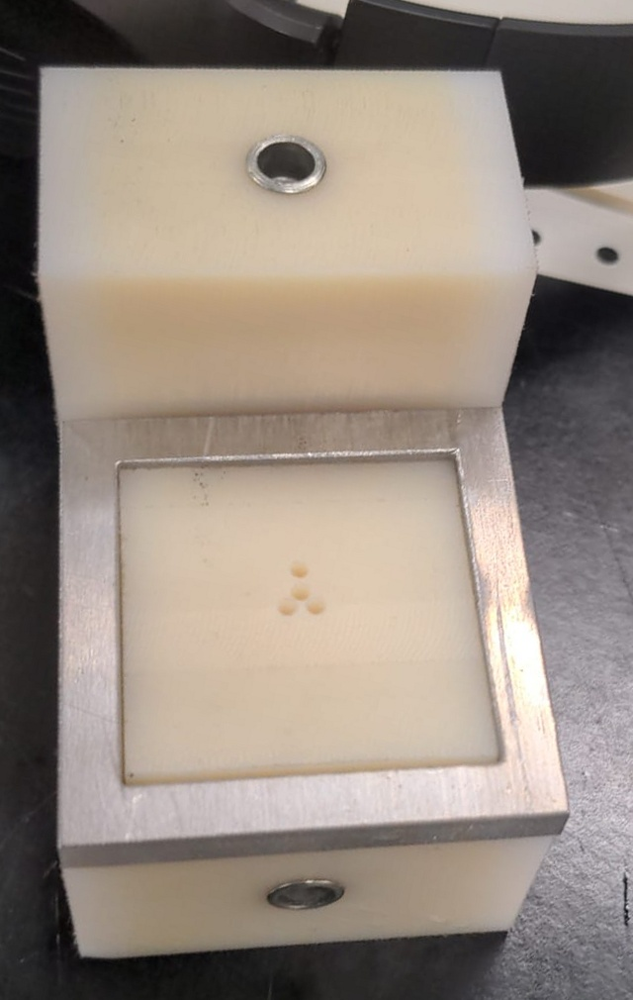
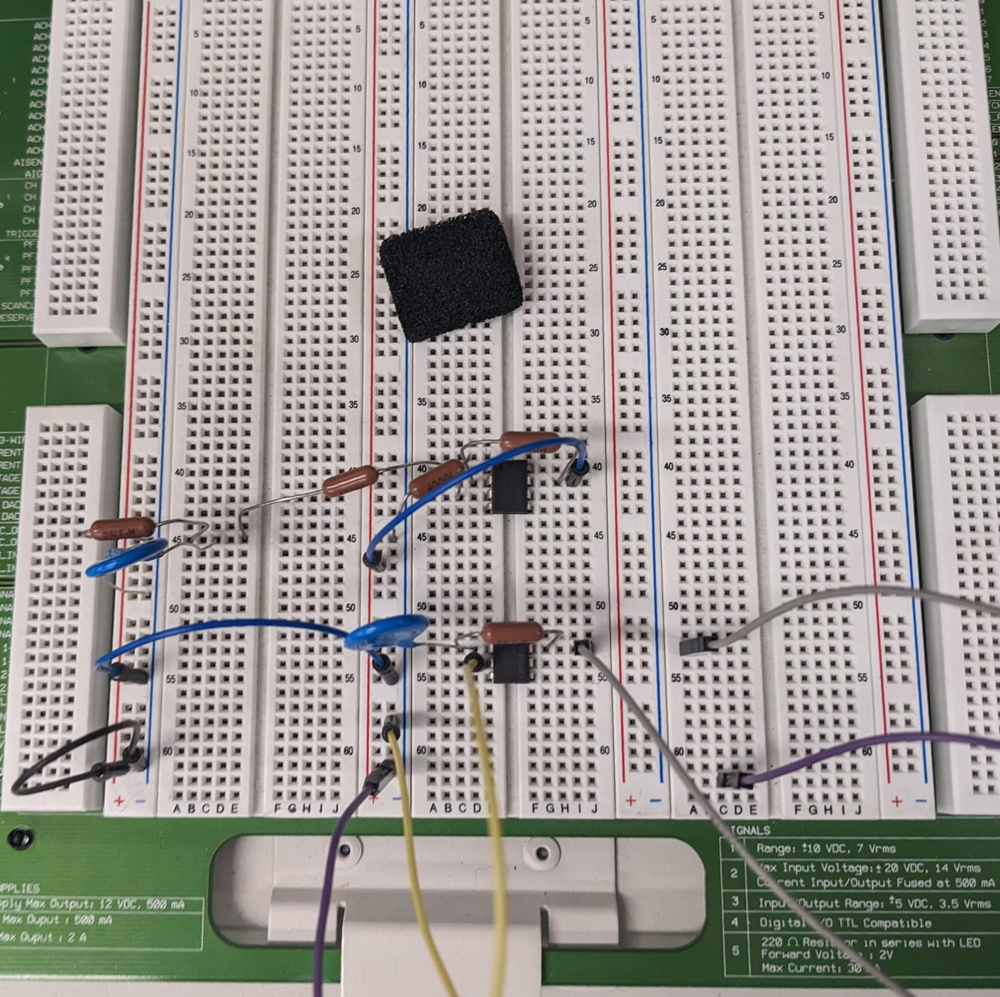
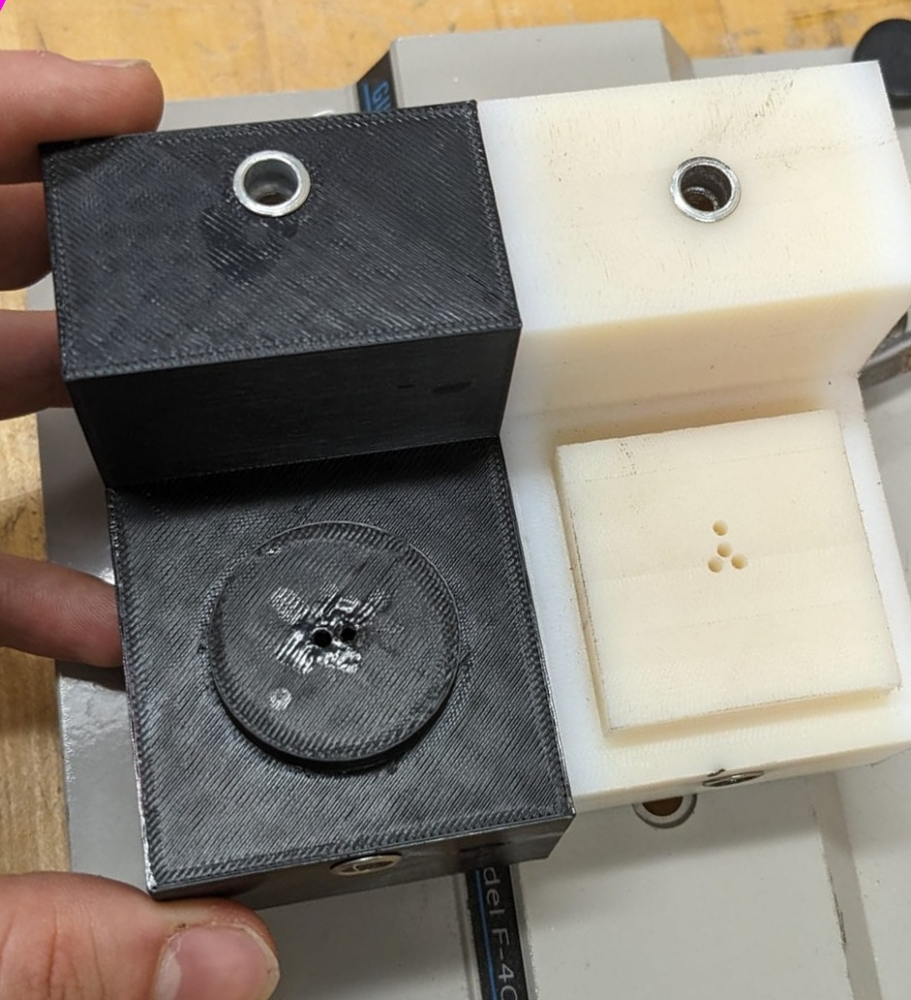
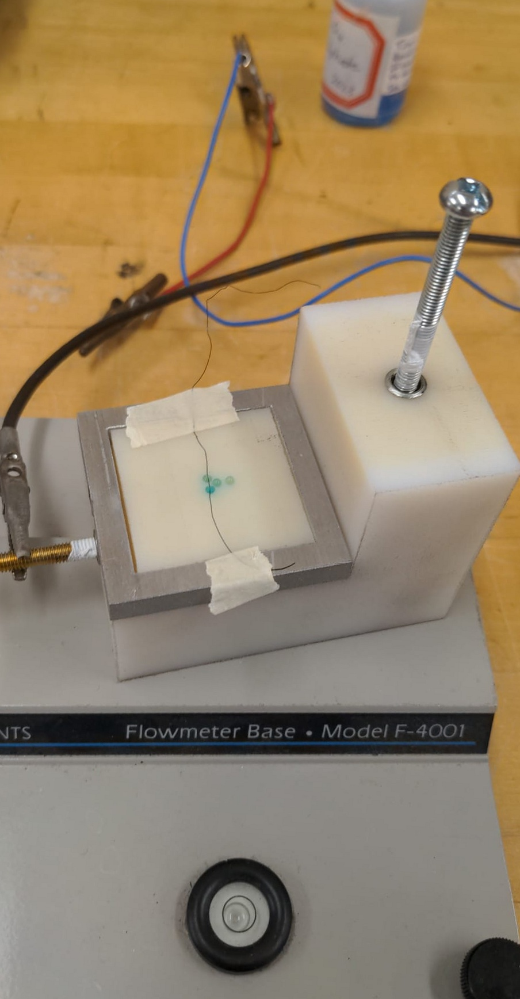
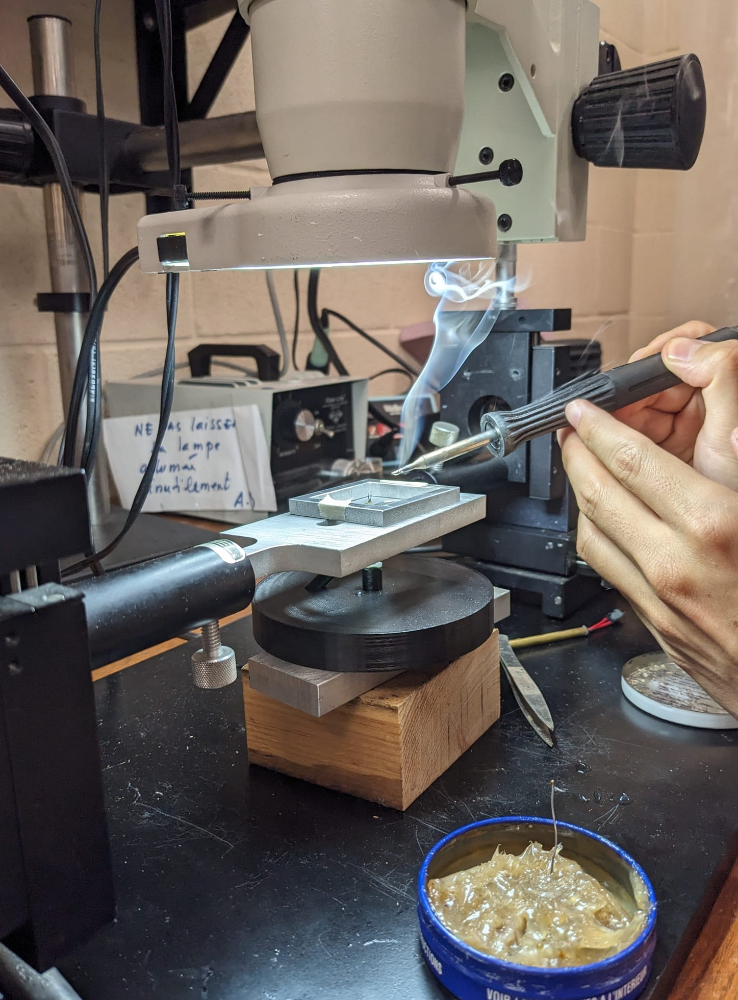

# Hot-Wire Repair Fixture

Project from my internship at the **Royal Military College of Canada**.

## Context
Hot wires are used to measure the velocity of an airflow. To repair one, the new
wire has to be attached to the **prongs** of the probe. I designed a dedicated
fixture for this, using a **copper deposit** followed by a **tin deposit**.

## Principle
1. **Copper deposit:** copper is deposited only on the **ends of the wire**,
   at the prong positions. The **middle of the wire must stay copper-free**.
2. **Tin deposit:** tin is then applied (arc welding), so the wire
   **grabs the prongs** of the probe through the copper-plated ends.

## How the copper deposit works
- A **copper screw** is the copper source and is consumed during the process.
- A **second screw** closes the electrical circuit.
- The **copper solution** and the screws let current pass, which allows the
  copper deposit.
- **Droplets of copper solution** are formed on the wire at the prong positions,
  so only those spots get copper. The **top screws** push the liquid in to
  form the droplets.
- **Small holes** in the fixture let the droplets of copper solution through.

## Design and manufacturing
- **CAD:** SolidWorks
- **Prototype:** 3D printed. It was not watertight, so the fixture was remade.
- **Final version:** watertight. A **square** shape was chosen because it is
  easier to machine.

## Measurement setup
A **Wheatstone bridge** is used with a **Pitot tube** to measure mean velocity.

## Images
| | |
|---|---|
|  |  |
| Fixture designed in SolidWorks, with the metal square. The holes let copper solution droplets through. | Wheatstone bridge used with a Pitot tube to measure mean velocity. |
|  |  |
| 3D-printed prototype (black, not watertight) next to the final watertight version (white). | Copper deposit in progress: consumed copper screw, circuit-closing screw, and droplets on the wire ends only. |
|  | |
| Tin deposit using arc welding, to attach the wire to the prongs. | |

## Tools
SolidWorks · 3D printing · machining · electrodeposition · arc welding · Wheatstone bridge · Pitot tube
